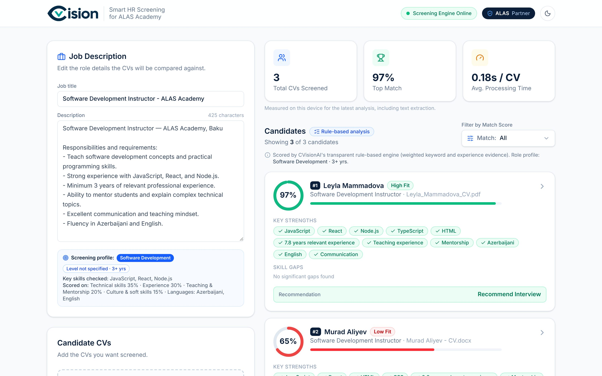
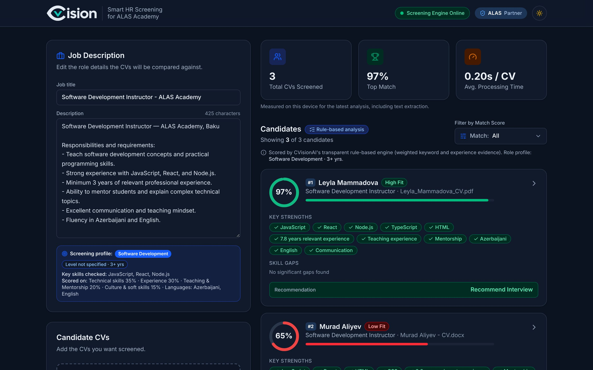
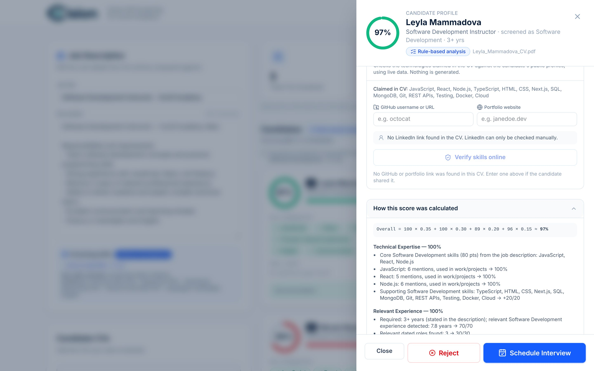
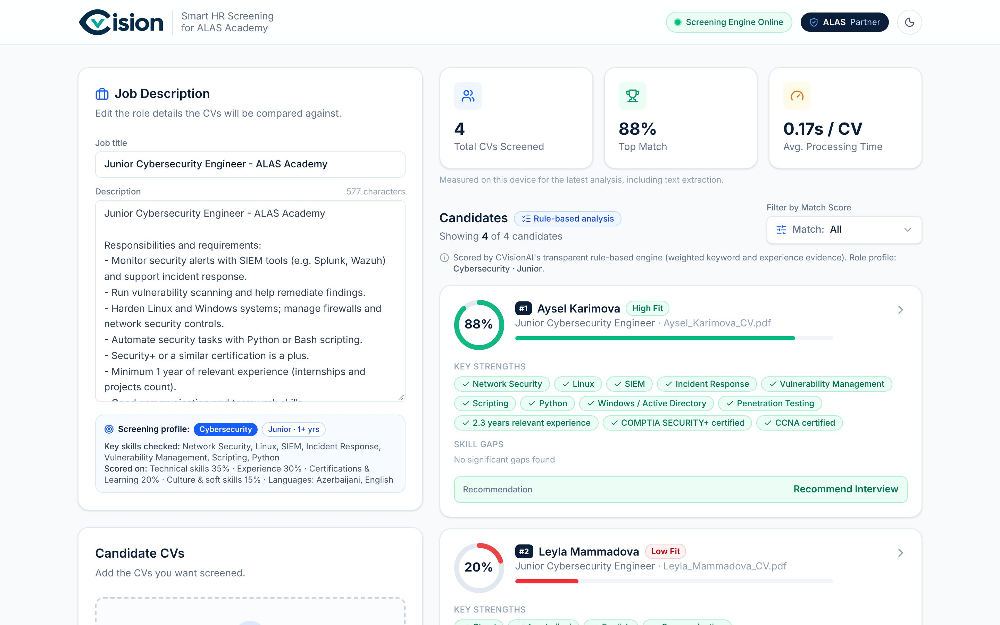

<p align="center">
  <picture>
    <source media="(prefers-color-scheme: dark)" srcset="public/brand/cvision-logo-dark.png">
    
  </picture>
</p>

<p align="center">
  <strong>Smart, explainable CV screening for ALAS Academy recruiters</strong><br>
  Upload CVs → score them against any job description → get a ranked, explained shortlist.
</p>

<p align="center">
  
  
  
  
</p>

<p align="center">
  
</p>

---

## What is CVision?

CVision is a hackathon MVP that helps recruiters at **ALAS Academy (Baku, Azerbaijan)** screen candidates faster without turning hiring into a black box. Recruiters paste a job description, drop in a batch of CVs, and get a ranked list where **every score can be traced back to evidence in the CV**.

It works **without any API key**: a transparent rule-based engine does the scoring. Adding a Gemini key is optional and switches on AI-assisted analysis, with an automatic fallback to the rule-based engine.

> CVision provides decision-support insights. Final recruitment decisions should always involve human review.

## Features

| | |
|---|---|
| **CV text extraction** | PDF (pdf.js) and DOCX (mammoth) are read **in the browser**. Corrupted, empty, password-protected, renamed and scanned (image-only) files are rejected with clear messages. |
| **Role-aware screening** | The job title + description become a *screening profile*: Software Development, Cybersecurity, Data & AI, DevOps & Cloud, UI/UX Design, Marketing, or General. Each has its own skills, relevant job titles and certifications. |
| **Explainable scoring** | Weighted score: Technical 35% · Experience 30% · Teaching & Mentorship *or* Certifications & Learning 20% · Culture & Soft Skills 15%. Every category lists the evidence behind it. |
| **Ranked results** | Candidates are sorted by score with a recommendation: **Recommend Interview** (85+) · **Hold** (70–84) · **Reject** (<70). Filter by score range. |
| **Skill verification** | Checks claimed skills against the candidate's **public GitHub** (own repos, languages, `package.json` dependencies) and portfolio website, using live data only. LinkedIn is linked for manual review. |
| **Recruiter actions** | Schedule Interview / Reject (with confirmation and undo) per candidate. *Demo: no emails are sent.* |
| **Optional AI** | With `GEMINI_API_KEY` set, Gemini scores each category; responses are validated, and CVision still computes the final score and verdict. |
| **Light & dark mode** | Follows the system setting, with a toggle in the header. |

## Screenshots

<table>
  <tr>
    <td width="50%"><p align="center"><em>Dark mode</em></p></td>
    <td width="50%"><p align="center"><em>Candidate panel: evidence behind the score</em></p></td>
  </tr>
  <tr>
    <td colspan="2"><p align="center"><em>Role-aware screening: a Junior Cybersecurity Engineer vacancy ranks the security analyst first</em></p></td>
  </tr>
</table>

## Quick start

**Requirements:** Node.js 20 or newer.

```bash
git clone https://github.com/Valehmammadov/CVision.git
cd CVision
npm install
npm run dev
```

Open <http://localhost:3000>, then drag the files from [`sample-cvs/`](sample-cvs) into the upload area and click **Analyze**.

```bash
npm run build   # production build
npm start       # serve the production build
```

> The scripts use Webpack (`--webpack`) for reliable Windows support.

## Configuration

**No configuration is required.** To enable optional features, copy the example file and fill in what you need:

```bash
cp .env.example .env.local      # Windows PowerShell: Copy-Item .env.example .env.local
```

| Variable | Required | Purpose |
|---|---|---|
| `GEMINI_API_KEY` | No | Enables AI-assisted analysis with Google Gemini. |
| `GEMINI_MODEL` | No | Gemini model name (default `gemini-2.5-flash`). |
| `GITHUB_TOKEN` | No | Raises the GitHub API limit for skill verification from 60 to 5,000 requests/hour. No scopes needed. |

🔒 **Keeping secrets safe**

- Keys live **only** in `.env.local`, which is ignored by Git (`.gitignore` → `.env*`). Only the empty template `.env.example` is committed.
- Keys are read **on the server only** (API routes in `src/app/api/`). They are never sent to the browser, and must **not** be prefixed with `NEXT_PUBLIC_`.
- The `public/` folder contains only static assets (logos, the pdf.js reader). It never holds keys or configuration.
- If a key is ever committed by mistake, **revoke it immediately** in the provider's console. Deleting the commit is not enough.

## How scoring works

```
Overall = Technical × 0.35 + Experience × 0.30 + (Teaching or Certifications) × 0.20 + Culture × 0.15
```

| Category | Rule-based scoring (summary) |
|---|---|
| **Technical** (35%) | Core skills for the role (from the description, or role defaults) = 80 pts. One mention ≈ 45%; more mentions and use in real work raise it; "basic/familiar" mentions are capped at 30%. Supporting skills add up to 20 pts. |
| **Experience** (30%) | Relevant years (dated roles in the field, overlaps merged) vs. required years = 70 pts; number of relevant roles = 30 pts. Seniority in the title sets the requirement (Intern 0 · Junior 1 · Mid 3 · Senior 5) unless the description states a number. |
| **Teaching & Mentorship** *or* **Certifications & Learning** (20%) | Teaching roles score teaching roles, activities and mentoring. Other roles score industry certifications (e.g. Security+, CCNA, AWS), continuous learning (courses, labs, CTFs) and knowledge sharing. |
| **Culture & Soft Skills** (15%) | Required languages and their stated level (50), communication (25), teamwork / problem-solving / leadership (25). |

Weights, thresholds and upload limits live in one file: [`src/config/screening.ts`](src/config/screening.ts).

**Limitations.** The rule-based engine reads keywords and simple patterns. It can't judge the depth or quality of someone's work, it may miss unusual wording, multi-column PDFs can be read out of order, and keyword-stuffed CVs can be over-scored. Scanned PDFs need OCR, which is not supported in this MVP. "No public evidence" on GitHub doesn't mean a skill is missing, because a lot of work code is private.

## Project structure

```
src/
├── app/
│   ├── page.tsx                 # Dashboard (client)
│   ├── layout.tsx               # Theme script, toaster
│   └── api/
│       ├── screen/route.ts      # POST: score CV text (rule-based or Gemini)
│       └── verify/route.ts      # POST: verify skills via GitHub / portfolio
├── components/                  # Header, JobDescription, CVUpload, CandidateList, CandidateDetailModal, …
├── config/screening.ts          # Weights, thresholds, limits — edit here
├── data/candidates.ts           # Types, demo candidates, default job description
└── lib/
    ├── screening/
    │   ├── extract.ts           # PDF/DOCX text + link extraction (browser)
    │   ├── profiles.ts          # Role profiles: domains, skills, seniority
    │   ├── ruleEngine.ts        # Explainable rule-based scoring
    │   ├── gemini.ts            # Optional Gemini evaluation (server only)
    │   └── links.ts             # GitHub / LinkedIn / portfolio link detection
    └── verify/                  # GitHub + portfolio verification (server only)
public/
├── brand/                       # CVision logo (light & dark)
└── pdfjs/                       # pdf.js runtime used for PDF reading
sample-cvs/                      # Fictional test CVs (+ error-cases/)
```

## Privacy & responsible use

- CV text extraction happens **in the recruiter's browser**. CV text is sent to Google only when the optional Gemini key is configured.
- Verification uses only links that the candidate included in their CV (or that the recruiter enters), and only public data.
- The AI prompt instructs the model to ignore protected characteristics (age, gender, nationality, religion…) and to treat CV text as untrusted data.
- All candidates in `sample-cvs/` and the demo data are **fictional**.

## Tech stack

[Next.js](https://nextjs.org) (App Router) · TypeScript · Tailwind CSS · shadcn/ui-style components · Framer Motion · Lucide icons · Sonner · [pdf.js](https://mozilla.github.io/pdf.js/) · [mammoth](https://github.com/mwilliamson/mammoth.js) · optional Google Gemini API · GitHub REST API

## Roadmap

- [ ] OCR for scanned PDFs
- [ ] Export shortlist (CSV / PDF)
- [ ] Real email integration for interview invitations
- [ ] Azerbaijani-language CV support
- [ ] Deployment

---

<p align="center">Built for a university hackathon in Baku, Azerbaijan · designed for ALAS Academy recruiters</p>
